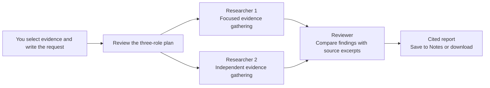

# NemoDoc

NemoDoc is a local-first notebook for source-grounded study and research. Ask questions about your PDFs and slides, run a reviewable team of three research agents, and inspect the evidence and activity behind each result.

## What stands out

- **Three-agent research:** two researchers investigate separate angles in parallel; a reviewer compares their findings with the original excerpts and writes a cited report. Review and edit the plan before a run starts.
- **Work you can inspect:** follow each agent’s assignment, model, progress and findings. Open the run trace to inspect model calls, evidence, tool inputs and results, citations, timing and errors.
- **Agent instructions you control:** set reusable `AGENTS.md` instructions for each connected runtime agent. For a research team, edit the instructions for each role in its plan.
- **Search provider choice:** connect Tavily, Exa or Firecrawl in **Settings → Search**. Save and test the connection, then choose whether to enable web research for each run.
- **Source-linked answers:** chat keeps your question as written and links answers to the relevant page. Save useful answers or research reports to Notes; build quizzes and other study materials in Studio.
- **Local documents:** read and annotate PDFs and slides in the browser, including OCR for scanned pages. Share selected extracted text with the agent workspace only when you approve it.

## How the three agents work

Choose sources and write a research request, such as: “Compare the study methods in these papers. Show where they agree, where they differ, and cite the supporting pages.” The default plan has three agents: two researchers and one reviewer. Review or change each assignment and its instructions, then start the team.



The researchers run concurrently. The reviewer starts after they finish. Each assignment has its own findings and usage record. A run is read-only; saving the report to Notes is a separate action.

## Follow the work

While a run is active, the research view shows each agent’s role, assignment, selected model, current stage, tool usage and findings. Stages include retrieving approved evidence, waiting for a model response, validating citations and reviewer synthesis. Expand **Run history and trace inspection** to see the recorded event stream, model request/response metadata, supplied excerpts, tool arguments and results, citation checks, timings and failures. Events arrive as the run progresses.

Traces are stored in `data/agent-traces.jsonl` by default, or PostgreSQL when configured. Download a credential-redacted JSON trace for review. Traces can still include your request and approved source excerpts, so inspect them before sharing. See the [research team and trace guide](docs/EVIDENCE_AGENTS.md).

## Configure agents and search

| Need | Where |
| --- | --- |
| Write a connected runtime agent’s reusable role and behavior | **Agent → Settings → Instructions** edits that agent’s `AGENTS.md`; `SOUL.md` is available for tone. |
| Set role-specific directions for a research run | Edit each agent’s **Instructions** while reviewing the team plan. |
| Use different models for planning, research and review | **Agent → Connections → Research models & task routing**. Profiles must pass the connection test before assignment. |
| Connect web search | **Settings → Search**; choose Tavily, Exa or Firecrawl, enter a key and select **Save & test search**. Enable web access separately for each run. |

Web search queries may include information from selected evidence and are sent to the chosen provider. Search results become citable only after the page content is read. Notebook-only research does not need a search provider. NemoClaw is optional for the application-managed research team.

More: [agent setup and model routing](docs/AGENT_CONNECTIONS.md) · [per-agent instructions and personal agent](docs/PERSONAL_AGENT.md) · [NemoClaw setup](docs/NEMOCLAW.md)

## Run locally

Requires Node.js 22.13 or newer.

```sh
npm ci
npm run dev
```

Open [http://127.0.0.1:5173](http://127.0.0.1:5173). Reading and annotation work without AI credentials. NemoDoc uses NVIDIA Nemotron by default; configure a model connection in Settings for live answers and agent runs.

## Files and privacy

Original notebooks and source files stay in browser storage. When you approve agent access, NemoDoc shares the selected extracted text with its local workspace. Hosted AI receives relevant source text or selected page images when needed for a request. Search providers receive web queries when web research is enabled. Search and research-model credentials are stored on the local server and omitted from API responses. Export notebook data or restore it from a ZIP backup.

[MIT license](LICENSE)
