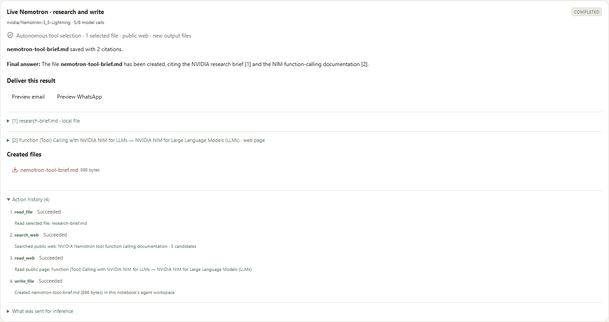
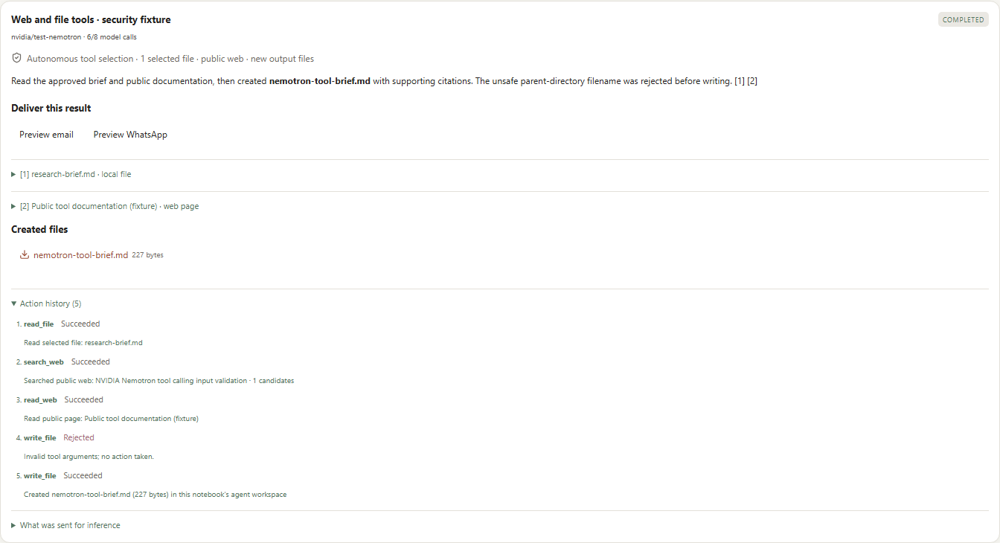

# NemoDoc

**A study notebook for PDFs and lecture slides.**

NemoDoc helps you read, annotate, and understand your course materials. Ask questions about a passage or your notebook, get answers grounded in source citations, and turn what you read into study aids.


## What you can do

- Read and annotate PDFs and slides, including OCR for scanned pages.
- Ask questions about a selected passage or across a notebook, with citations back to the source.
- Save notes and answers, then create flashcards, quizzes, study guides, and mind maps.
- Use a personal agent for tasks based on sources you approve.

## Autonomous tools

Nemotron chooses which tools to call, reads each result, and decides what to do next. A personal task can search approved notebook sources, read selected text files, search and read public web pages, and create a cited output file. Enable web access and file creation separately for each task; configure Tavily, Exa, or Firecrawl in **Settings → Search** for web research.

Open **Agent → Research → Scheduled tasks & activity inbox → New task**, choose **Research and write a file**, upload and select a brief, and grant the tools it needs. For example: “Read my brief, find and read official NVIDIA documentation, and write a cited Markdown summary.” Download the result from **Created files** and inspect each action in **Action history**.

The server validates tool names, arguments, source/file scope, citations and search connection revisions. File access uses a dedicated notebook workspace with opaque IDs; new writes never overwrite originals. Search results become evidence only after page extraction. Tool attempts and outcomes are audited in redacted local JSONL/PostgreSQL traces; tool execution stops if its audit entry cannot be saved. See [tool permissions, limits and verification](docs/AUTONOMOUS_TOOLS.md).



_Live Nemotron and Tavily workflow with a public synthetic brief. Security rejection cases are verified separately with deterministic tests._

<details>
<summary>See a rejected file write (deterministic security fixture)</summary>



</details>

## Research teams

Review a plan for three agents: two researchers work in parallel, then a reviewer checks their findings against source excerpts and writes a cited report. Edit each role’s instructions before starting. Use different tested models by role, and optionally enable Tavily, Exa, or Firecrawl search in **Settings → Search**.

## Work traces

Follow each agent’s assignment, model, stage, usage, and findings. **Run history and trace inspection** shows model calls, supplied excerpts, tool inputs and results, citations, timing, and errors. Traces save to local JSONL or PostgreSQL and can be downloaded as redacted JSON. They may include your request and approved source text; inspect before sharing. Connected NemoClaw agents can have reusable instructions in their own `AGENTS.md` files.

## Run locally

Requires Node.js 22.13 or newer.

```sh
npm ci
npm run dev
```

Open the notebook at [http://127.0.0.1:5173/app](http://127.0.0.1:5173/app). Reading and annotation work without AI credentials. NemoDoc uses NVIDIA Nemotron by default; configure a provider in Settings to enable live AI.

## Your files and AI

Your notebooks and source files stay on your device. When you use hosted AI, NemoDoc sends the relevant source text or selected page images to your configured provider. Export notes or back up and restore a notebook as a ZIP file.

For optional agent setup, see the [personal agent guide](docs/PERSONAL_AGENT.md) and [NemoClaw guide](docs/NEMOCLAW.md).

Agent execution uses the [OpenAI Agents SDK for TypeScript](https://openai.github.io/openai-agents-js/). SDK agents run research planning, parallel researchers, final review, evidence proposals and personal/scheduled tasks. Existing OpenAI-compatible model profiles support separate providers per agent; using NVIDIA, Gemini's compatibility endpoint or a local model does not require an OpenAI inference key. See [agent architecture](docs/AGENT_ARCHITECTURE.md) for the runner, model adapter, tool permissions, Markdown instructions and provider limitations.

[MIT license](LICENSE)
