# NemoDoc

**Your PDFs and lectures, turned into a notebook you can think with.**

NemoDoc is a local workspace for PDFs and lecture slides, powered by NVIDIA Nemotron by default. Read and annotate your sources, ask about a selected passage or your whole notebook, and keep useful, cited answers close at hand.

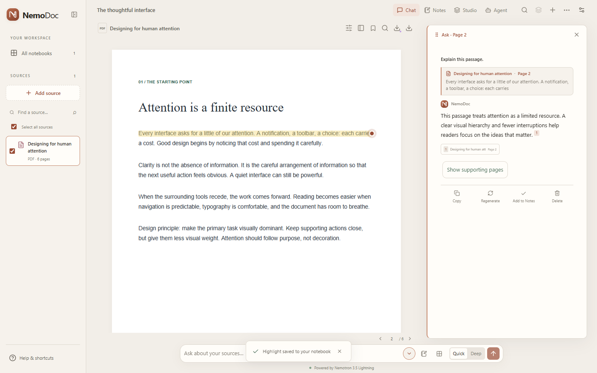

## The NemoDoc MVP, in 30 seconds

[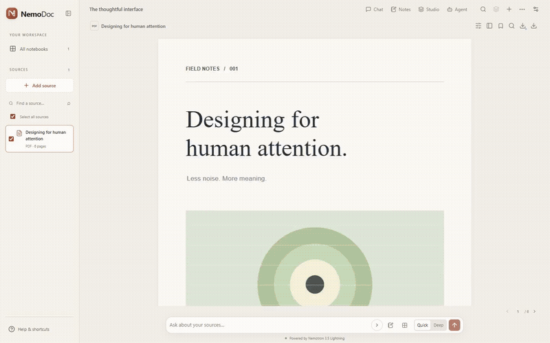](docs/demo/nemodoc-mvp-tour.mp4)

[Watch or download the full product tour (MP4)](docs/demo/nemodoc-mvp-tour.mp4)

The tour uses the included sample notebook with deterministic demo responses. No model credentials or email/WhatsApp delivery are used. Live answers and agent runs use the connections configured in the app.

## What the MVP includes

- **Read and annotate.** Bring PDFs or lecture slides into a notebook. Read in vertical, horizontal, or book layout; highlight, underline, add notes, draw, search, bookmark, and run OCR on scanned pages.
- **Ask in context or across a notebook.** Explain, define, or ask about a selected passage in its own panel. Use the separate bottom chat for broader questions. Follow citations to source pages and inspect supporting excerpts.
- **Keep your own notes.** Review saved answers, highlights, and notebook notes in Notes. Export those notes as Markdown, or back up and restore the full notebook as ZIP.
- **Study from your sources.** Build flashcards, quizzes, study guides, and mind maps in Studio.
- **Delegate with control.** Approve sources and notes for the personal agent, reuse skills and memory, schedule weekday tasks, and configure delivery through your existing SMTP mailbox or WhatsApp Business connection.

<details>
<summary><strong>Browse screenshots of the app</strong></summary>

### Reading, selection tools, and highlights

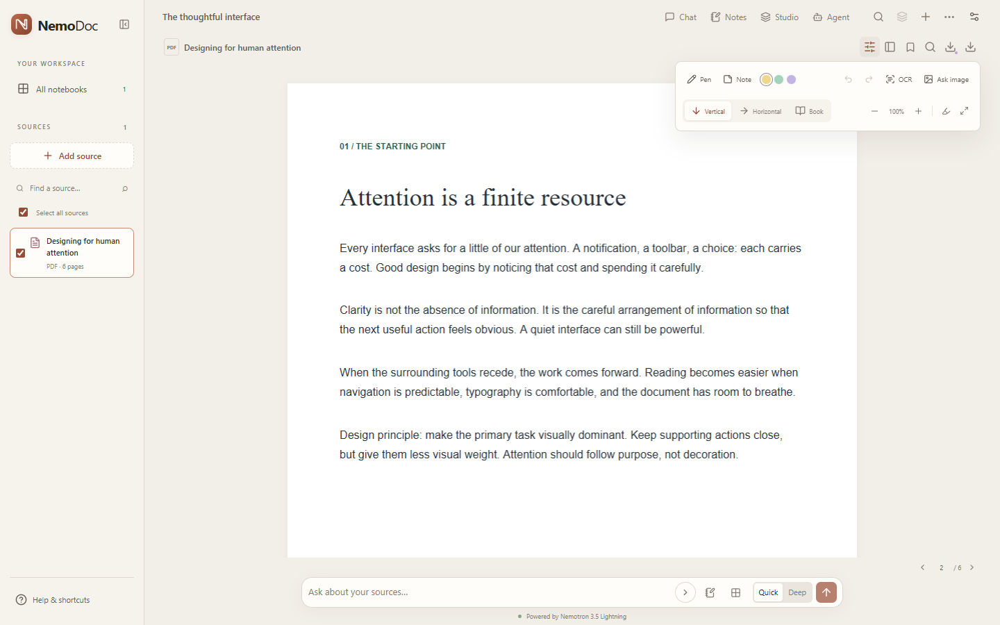

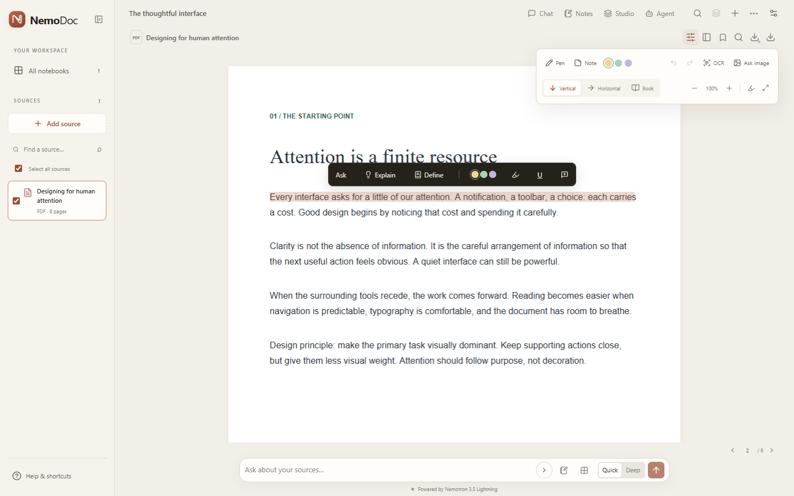

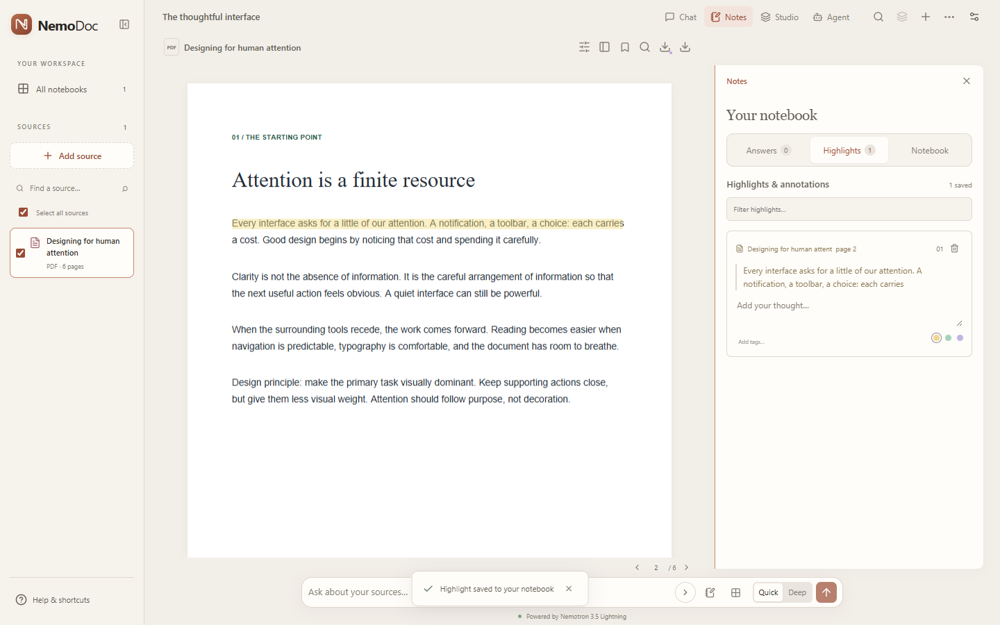

### Contextual answers, notebook chat, and export


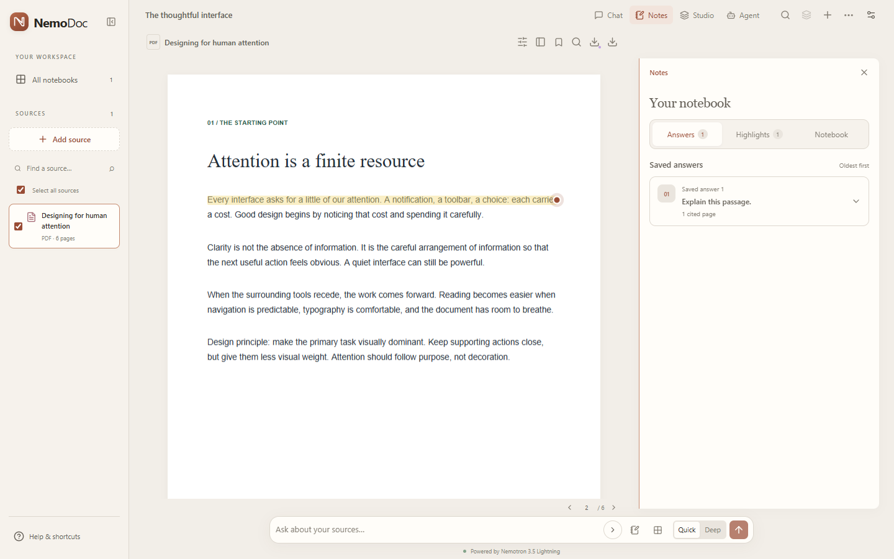

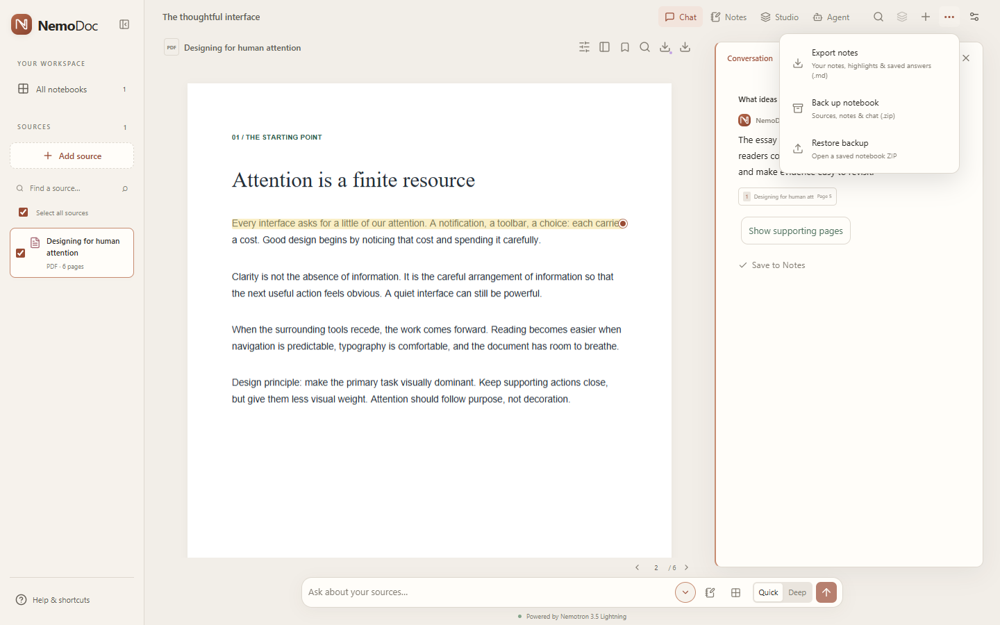

### Study and agent workflows

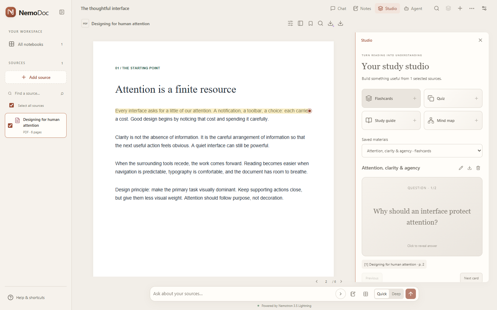

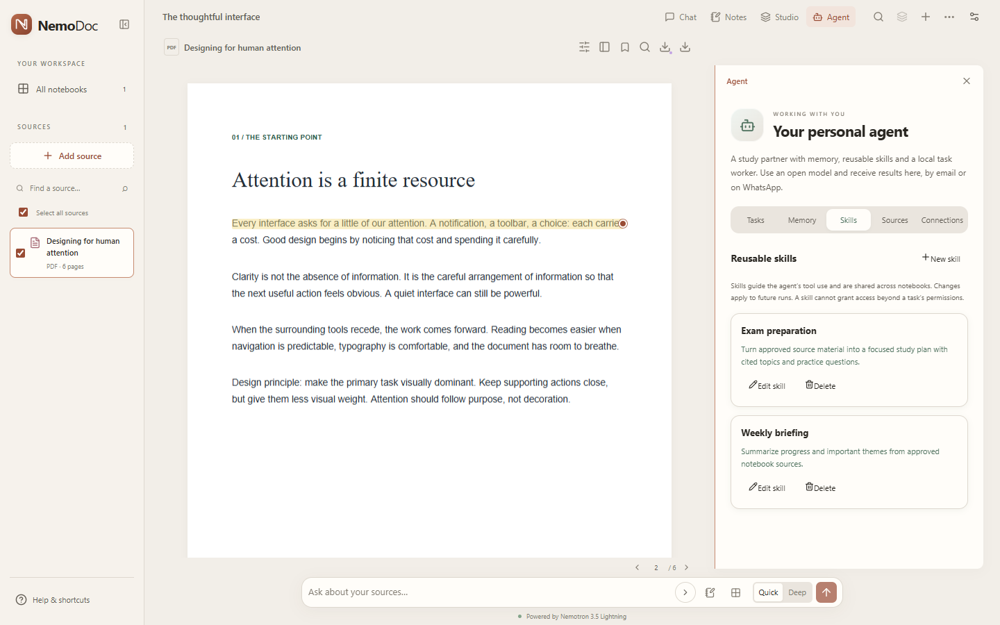

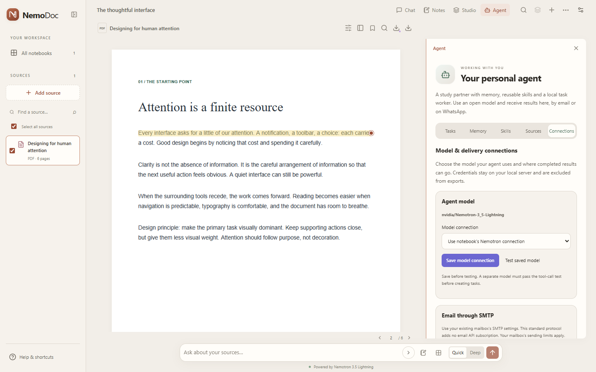

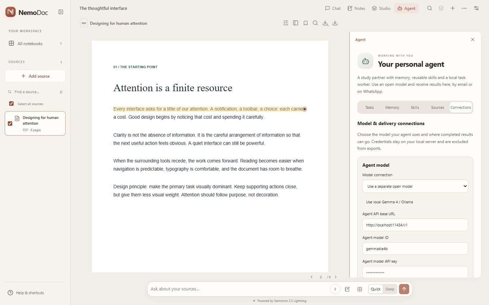


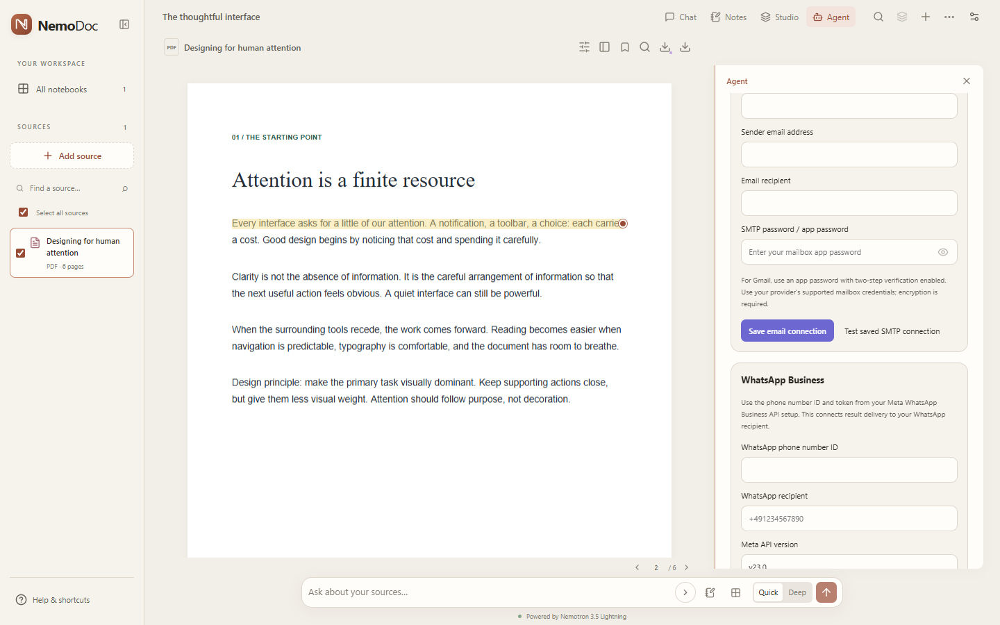

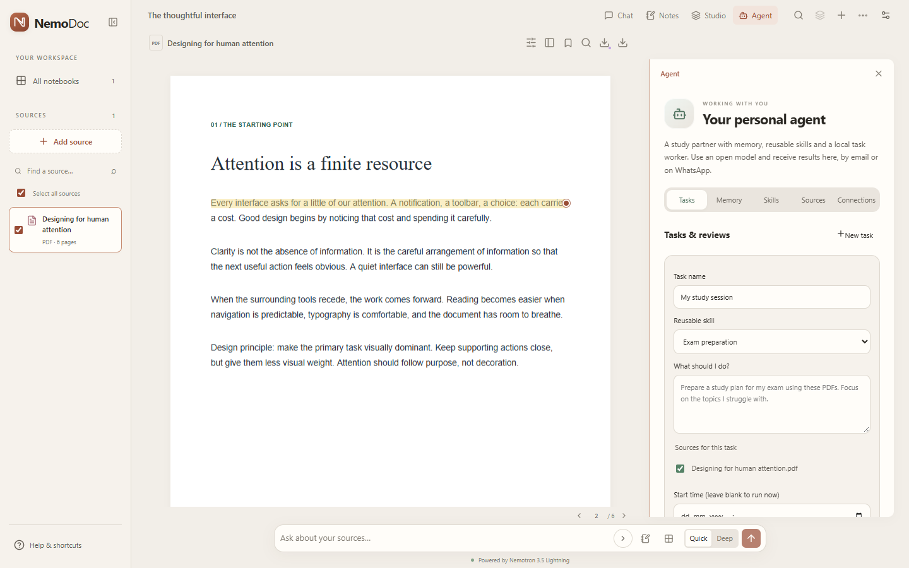

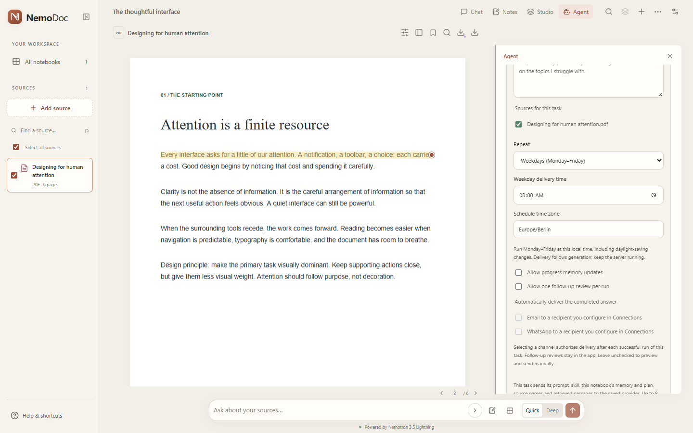

</details>

## Try it locally

### Evidence-based agents with PostgreSQL

**Agent → Tasks** now includes **Plan revision** and **Synthesize research**. Explicitly share selected note/document snapshots, inspect scoped relational queries and original passages, edit the proposal, then approve selected materials, plan changes, reviews and optional previewed email. Nothing in these workflows is applied before approval.

For PostgreSQL 17 and the app together, set the two database passwords in `.env` and run `docker compose up --build`. The app is available at [127.0.0.1:3001](http://127.0.0.1:3001); the database has no public host port. Existing `npm run dev` continues supporting local JSON mode.

See the [workflow and implementation guide](docs/EVIDENCE_AGENTS.md) for schema, SQL tools, approval transactions, outbox recovery, backups, CI and the credential-free 40-case evaluation set. The [MML live workflow instructions](docs/MML_WORKFLOW_TESTING.md) cover the study workflow. [Verification status](docs/EVIDENCE_VERIFICATION.md) distinguishes credential-free tests from live model evaluation.

#### Research example sources

To try a live comparison, download and add both PDFs to a notebook, approve their snapshots in Agent, then choose **Synthesize research** and select both sources:

- Ritchie et al. (2013), primary-school learning: [article](https://journals.plos.org/plosone/article?id=10.1371/journal.pone.0078976) · [PDF](https://journals.plos.org/plosone/article/file?id=10.1371/journal.pone.0078976&type=printable)
- Okano et al. (2018), workplace digital learning: [article](https://journals.plos.org/plosone/article?id=10.1371/journal.pone.0206250) · [PDF](https://journals.plos.org/plosone/article/file?id=10.1371/journal.pone.0206250&type=printable)

They examine different learning settings, so their results are not a direct head-to-head comparison.

[Recorded evaluation results](docs/MML_EVALUATION_RESULTS.md) preserve the earlier live-model batch and stress checks; they are historical and do not score the new structured reports. [Reproduction instructions](docs/MML_WORKFLOW_TESTING.md) keep the book, credentials and raw traces local; structural passes are not model accuracy.

[Watch the revision and research workflow walkthrough (WebM)](docs/demo/evidence-workflows.webm) — actual UI/API/PostgreSQL with scripted provider responses; no live model score or external delivery is implied.

Install **Node.js 22.13 or newer**, then run:

```sh
npm ci
npm run dev
```

Open [localhost:5173](http://127.0.0.1:5173). Reading and annotation work without model credentials. To enable live AI, open **Settings → Nebius**, enter your **Nebius Token Factory API key**, and choose **Save & test**.

Settings loads the saved provider's model catalog into the **Chat & study model** dropdown and labels each option **Text** or **Vision**. The provider determines which model IDs are available; refresh after changing the connection. Chat, passage answers and study tools use that selection. OCR and image questions use the separate **Image model** dropdown and its **Save & test image model** button; semantic search uses the embedding model. The agent can use the notebook connection or its own tested model connection.

Notebooks stay on your device; hosted AI receives relevant text or selected page images. Export notes or back up notebooks as ZIP files.

### OCR, image questions, and notes search

Nemotron 3.5 Lightning is text-only. **Settings → OCR & images** configures a separate vision model for scanned-page recognition and image questions. Nebius presets MiniCPM-V-4.5; NVIDIA hosted presets Nemotron Nano VL. Check the saved provider's catalog and test the connection because hosted availability can change. OCR text stays in the local source and participates in selection and search.

**Search ideas → Notes** searches saved answers, passage notes, highlights, and notebook notes. To use [EmbeddingGemma 2](https://ai.google.dev/gemma/docs/embeddinggemma) locally, install and start Ollama, then run:

```sh
ollama pull embeddinggemma-2:270m
```

Choose **Settings → Search & embeddings → Use EmbeddingGemma 2 locally**, then **Save & test embeddings**. The 270M text variant serves note and source search at `http://127.0.0.1:11434/v1`; Nemotron remains the chat model. Other OpenAI-compatible embedding endpoints and model IDs are editable. Search uses keywords if no embedding model is configured. Cached embeddings are regenerated when note text or model settings change.

### Open models and agent delivery

NemoDoc agents use the notebook's Nemotron connection by default, or a separate tool-capable open model such as Gemma through Ollama. Weekday schedules use a chosen local time and time zone. See the [agent connections setup guide](docs/AGENT_CONNECTIONS.md).

For agent isolation, choose **OpenClaw agent through NemoClaw** in Connections. The [NVIDIA NemoClaw setup guide](docs/NEMOCLAW.md) includes a dedicated agent manifest, host preflight and private gateway configuration. NemoDoc retains scoped evidence tools and approval before delivery; the app and database keep their existing deployment.

**Agent → Agents** shows the sandbox’s agent roster, models and reported work, with activity filters and notebook tool history. Live session monitoring uses the NemoClaw CLI on the runtime host; a remote gateway provides agent inventory with a clearly marked limited view. See [monitoring setup](docs/NEMOCLAW.md#see-your-agents-and-their-work).

**Agent → Settings** creates and configures individual OpenClaw agents with their own primary model, ordered fallbacks and Markdown roles. Edit `AGENTS.md` for role instructions and `SOUL.md` for personality, or insert a role template while preserving existing instructions. See [agent configuration](docs/NEMOCLAW.md#assign-models-and-markdown-roles).

## More

[Personal agent guide](docs/PERSONAL_AGENT.md) · [Real book demo verification](docs/MML_VERIFICATION.md) · [MIT license](LICENSE)

### Local verification

Run `npm run verify` for dependency-boundary checks, TypeScript, unit/API tests, and the production build. `npm run verify:agents` builds and drives agent monitoring/settings in an isolated browser session, retaining traces in `output/verification/`. It needs Playwright Chromium; set `PLAYWRIGHT_CHROMIUM_EXECUTABLE_PATH` to use an installed browser. The [verification skill and feature map](.cursor/skills/verify-nemodoc/SKILL.md) describe the journeys, cleanup, and external-runtime limits.
