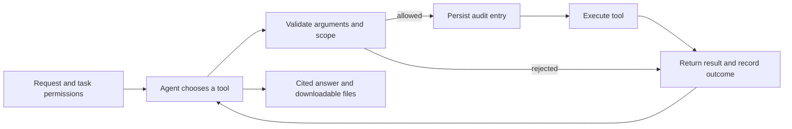

# Autonomous agent tools

Personal tasks use the shared OpenAI Agents SDK runner with `tool_choice: "auto"` and the saved compatible model connection. The model selects tools and their order; the application validates and executes each request and returns its actual result. Tools are advertised only when the task permits them. Forged calls to unadvertised tools are also rejected on the server.

## Create a task

1. Configure and test the agent model connection. For web work, save and test a provider in **Settings → Search**.
2. Open **Agent → Assistant** and describe the task. Add task instructions directly; choose a reusable skill under **Task settings** when needed.
3. Select approved notebook sources, upload/select text files, or allow web research. A task needs at least one of these evidence sources. Uploading creates a local copy; selecting it grants the task read access.
4. Enable **Allow public web search and page reading** and **Allow new output files…** when needed. Give a concrete request such as “Read my brief, search official documentation, and write a cited Markdown summary.”
5. Choose delegation when the main agent should assign independent questions to specialists. **Specialist instructions** lets you guide notebook researchers and web researchers separately. These instructions are saved with the run.
6. Inspect expandable tool actions, specialist findings, cited excerpts and **Created files**. The notebook dashboard retains previous runs, and **Download trace** exports the saved audit. File downloads contain the actual generated files.

## Tool authority

| Tools                                          | Enforced scope                                                                                                                                                            |
| ---------------------------------------------- | ------------------------------------------------------------------------------------------------------------------------------------------------------------------------- |
| `search_sources`, `read_passage`               | Only the task’s approved notebook source IDs and available pages.                                                                                                         |
| `list_files`, `read_file`                      | Only selected file IDs and files created in this run, in the same notebook.                                                                                               |
| `search_web`, `read_web`                       | Task opt-in and the saved, tested search connection revision. Read URLs must come from this run’s search results. Only successfully extracted pages receive citation IDs. |
| `write_file`                                   | Task opt-in; new files in the notebook’s dedicated agent workspace. Retrieved citation IDs are required; inline references must match them.                               |
| `delegate_agents`                              | Task opt-in; notebook and web researchers use the same SDK runner with inherited read permissions. Specialists cannot mutate data or delegate recursively.                |
| Study materials, plan, memory and review tools | Existing notebook scope and task-specific memory/scheduling permissions.                                                                                                  |

Files support `.md`, `.txt`, `.csv` and `.json`, up to 64 KiB each, 20 selected inputs per task, and 100 files/2 MiB per notebook. Filenames cannot contain directories, traversal components, control characters or reserved device names. Physical paths use generated IDs under `data/agent.json.files/` (or the configured agent data filename plus `.files`). Symlinks/junctions, hard-linked files, non-regular files and oversized reads are rejected. Writes create new IDs exclusively, even for the same display name. There is no arbitrary host-path, shell or executable-file tool.

Ordinary runs retain the limits of eight model calls, twenty tool actions and three minutes. Delegated runs share 34 model calls, 40 tool actions and five minutes: at most four specialists, three concurrent per batch, and six model calls per specialist. The main agent owns the final response. Source revocation, cancellation and model changes stop subsequent actions; changed search settings require a new task. Output metadata and specialist results survive restart and interrupted actions are not replayed. **Erase all agent data** removes registered sandbox copies and generated files with the agent history; notebook originals remain in browser storage. Redacted traces are stored separately and retained by this control.

Web specialists can discover papers or pages through the selected search provider and extract relevant text. Search snippets alone cannot support claims, and PDF extraction depends on the provider's supported content. Empty searches produce an explicit no-evidence result; failed page extraction records the error instead of inventing a finding.

## Audit and privacy

Markdown writes require each declared supporting citation ID to appear inline. JSON outputs must parse as JSON; their numeric arrays remain data and their provenance is retained in file metadata.

Tool requests record their call ID, validation/rejection decision, result/error and timing. An allowed decision must reach PostgreSQL or the local JSONL spool before execution; both destinations failing blocks the action. Successful, rejected and failed outcomes appear in the activity inbox. Traces redact configured credentials and private model reasoning. They can contain approved text; inspect exports before sharing.

The activity feed groups work by agent and shows the actual persisted tool actions and validated findings. Nested trace spans retain each specialist's assignment, instructions, status and model. Dashboard queries and trace reads are scoped to the current notebook.

Web queries go to the search provider. Retrieved file/page text, task context and accumulated tool results go to the model. Files and pages are untrusted text and cannot grant new tools or host paths. These controls enforce application permissions; they do not guarantee correct model claims or eliminate malicious instructions within granted authority. NemoDoc remains a single-user local application, not a multi-user authentication service or an operating-system sandbox.

## Reproduce verification

`npm run verify` runs static, unit/API and production-build checks. `npm run verify:agents -- autonomous-tools.spec.ts` owns an isolated local server and browser. It exercises the real upload/task/worker/download UI with deterministic provider boundaries: file/web tools, a rejected traversal write, input preservation, audit events, download bytes, reload persistence and mobile overflow. Fixtures do not prove provider availability or model quality.

For a paid live run, explicitly set `NEMODOC_AUTONOMOUS_LIVE=1` and run the same browser command. It reads only the saved model configuration (or `.env` Nemotron defaults) and `TAVILY_API_KEY` from ignored `data/autonomous-live.env`. Keep keys out of commands and Git. Setup saves/tests Tavily in a separate verification workspace. The input is a public synthetic brief; the ordinary worker chooses real tool calls, with no mocked model responses or tool results. Evidence stays under `output/autonomous-live-*` and `output/verification/`.

The README screenshot is captured from the live UI. Security tests separately cover denied tools, out-of-scope IDs, invalid arguments, traversal, links, citation integrity, changed search settings and unavailable audit storage. A screenshot or live sample does not prove general factual accuracy.

## Live delegated research — 2026-10-27

An isolated public-paper task used `nvidia/nemotron-3.5-lightning-30b-a3b` through NVIDIA and Tavily. The initial run found and extracted sources but failed after the specialists and main agent exhausted their call budgets. After increasing the delegated limits and reserving a final answer turn when evidence exists, a second run completed with two web specialists and 16 model calls; it extracted portions of the FlashAttention and linear-attention papers. A third completed run used 34 calls, including a retry after one specialist failed citation validation, and relied largely on arXiv abstracts. All model and Tavily requests in those samples returned HTTP 200.

The completed answers still contained claims that were incorrect or not clearly supported by the retrieved excerpts. Citation validation checks reference identity and syntax, not whether a source entails a claim. Research results require source review; completed runs do not establish factual accuracy or full-paper analysis. Local redacted traces and summaries are retained in ignored `output/live-nvidia-research-*` directories.

## Live record — 2026-10-23

The final isolated browser run used `nvidia/Nemotron-3_5-Lightning` through Nebius Token Factory and real Tavily search/extraction. Nemotron chose `read_file`, `search_web`, `read_web` and `write_file`; all four actions succeeded. Five inference responses returned HTTP 200 with matching model IDs. Four Tavily requests covered connection search/extraction and the task's search/extraction. The run persisted 64 trace events, and the browser verified the downloaded Markdown bytes, declared inline citations, original-input preservation, reload persistence and mobile layout.

The completed UI is in `docs/screenshots/autonomous-tools-live.png`. The separate security screenshot uses deterministic provider responses and shows a rejected traversal filename; it is not presented as a live model refusal. Local receipts, traces, video and generated output are retained in ignored `output/autonomous-live-OYSN46/`; the browser report is in `output/verification/report/index.html`. These checks establish this workflow sample and reference integrity, not general model accuracy.
