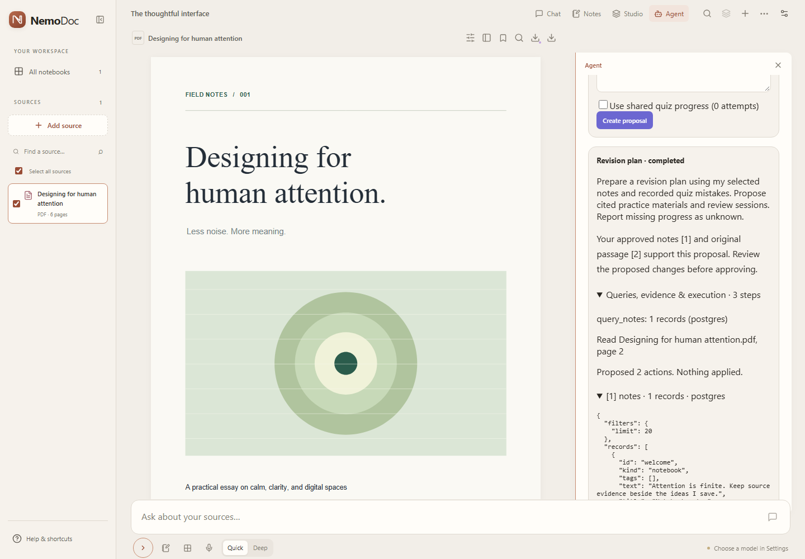
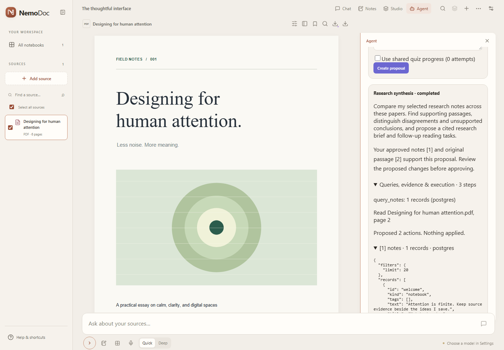

# Evidence workflows verification

Verified locally on Windows, 14 October 2026. This report records engineering checks, not live model accuracy.

| Boundary | Evidence |
|---|---|
| Both workflows | Credential-free browser test exercises explicit snapshot approval → scoped query and passage inspection → proposal edit/revision → selected approval → stable Studio import. Passed against JSON and real PostgreSQL 17.9. |
| SQL | PostgreSQL integration test exercises numbered migrations twice, scoped notes/tag/date queries, immutable quiz aggregation, malicious filter strings, restricted-view role, concurrent duplicate approval, rollback, stale proposals, research runs and interrupted execution/email recovery. Passed on an isolated loopback database. |
| Email | Local TLS SMTP server receives one reviewed message only after approval. Changed recipient revision rolls back all actions; retrying an approval does not send again. No external mailbox involved. |
| Deterministic suite | `npm test`: **101 passed**, zero failed. Includes existing behavior, workspace permissions, immutable attempts, approvals, scheduling, local TLS SMTP, MML rubric checks, suspend deadlines and malformed provider output. |
| Browser regression | `npm run test:e2e`: **36 passed**, four explicitly opted-in live tests skipped. Covers desktop/mobile reading, Book mode, current composer, notes, Studio, backups and both workflows. Ordinary tests mock prompt rewriting and isolate workspace endpoints from personal server data. The real-model MML browser workflow passed separately. |
| TypeScript/build | `npm run check` and `npm run build` passed. Vite reports its existing large-chunk advisory; the build completes. |
| Live model | The final MML batch passed **37/40 structural checks**, with **34/40** on a stricter instruction audit. These are not factual accuracy. See [actual MML results and representative content failures](MML_EVALUATION_RESULTS.md); the original synthetic 40-case fixture remains a separate suite. |
| Docker and CI | Compose, Dockerfile and GitHub Actions are provided. Docker is unavailable on this machine, so container startup has not been executed here. A GitHub run reached the browser suite and exposed the queue race documented below. The correction passed five delayed-request runs each with JSON and PostgreSQL locally; a successful post-fix GitHub run is still pending. |

## Recorded walkthrough

[Watch both evidence workflows (WebM)](demo/evidence-workflows.webm)

This recording uses the actual browser UI, Express API and PostgreSQL 17.9, with a **scripted provider**. It shows revision and research templates, approved local sample notes, query records, original-page references, edits, approvals and duplicate-safe Studio import. It is a workflow demonstration, not evidence of model answer quality. Model text is deterministic and no external mail is sent.

Reproduce with `npm run demo:workflows`; configure isolated `TEST_DATABASE_URL` and `TEST_READ_DATABASE_URL` to use PostgreSQL (otherwise the recorder uses JSON). The generated WebM is written to `docs/demo/evidence-workflows.webm`. Tests only use the included sample document and synthetic notebook content. They do not use the user's browser profile.

## Representative failures found and corrected

- PostgreSQL JSONB reorders object keys. Initial strict JSON-string comparisons incorrectly rejected repeated quiz snapshots and unchanged provider connections. Canonical object fingerprints now compare semantic object content; the real database regression test covers this.
- Relational reference rows return in database order. Reference-set normalization now keeps identical refreshes and repeated immutable attempts idempotent when their input reference order differs.
- The initial proposal textarea relied on an implicit label that browser automation did not resolve consistently. The editor now supplies an explicit accessible name; both workflow edit/approve browser checks pass.
- A sandbox-only temporary-file rename restriction affected the persistence test. The test passed with normal temporary-file permissions; production persistence still uses write-then-rename and keeps rollback behavior.
- GitHub CI exposed a browser-test queue race: clicking Create proposal did not wait for its PostgreSQL transaction before manually ticking the test worker, and a previous completed card could satisfy the next run's assertion. The tests now wait for the POST response and bind all checks to its returned run ID. A deliberately delayed queue request reproduced the failure before the fix; repeated JSON/PostgreSQL browser runs verify the correction without increasing the ordinary assertion timeout.
- Real MML extracted text contained NUL separators, which PostgreSQL UTF-8 text rejects. Approved snapshots now remove these separators while preserving Unicode, page positions and the original browser content; a regression test covers the boundary.
- The live model could spend its whole budget retrieving pages. The worker now reserves proposal/final-answer calls once query and document evidence exist, reports specific argument-validation errors, and reminds the model to use exact selected source IDs. A deterministic regression checks the forced proposal transition and verifies no actions are applied.

## Live MML demonstration, 14 October 2026

The saved Nebius connection ran **nvidia/Nemotron-3_5-Lightning**, without a scripted provider, against the selected MML highlight and approved extracted text from `mml-book.pdf`. PostgreSQL **17.9** stored one selected document, 417 page snapshots, one note, tool steps and proposals. Read queries used the separate `agent_reader` role.

Two initial broad requests exhausted their bounded call budgets (8 and 12 calls); both failures remain in the audit history. Two subsequent focused runs completed in **7 model calls each**: one proposed a cited basis/norm study guide, and one proposed two review tasks. The latter was edited through the browser and persisted as proposal revision 2, pending approval. No materials, scheduled reviews, approval receipts or email-outbox entries were applied during this demonstration.

The review proposals are Basis recall (15 October, 18:00 Europe/Berlin) and Norm practice (16 October, 18:00 Europe/Berlin). The first completed run correctly reported missing quiz history, but its narrative mentioned reviews that were absent from its actual one-action proposal; the separate focused run produced both structured review actions. The structured proposal remains the authoritative approval surface. These observations are a small live demonstration, **not** a 40-case evaluation score or proof of general model accuracy.

Remaining V1 limits: one local app worker, no internet-facing tenancy/authentication, fixed context/tool budgets, lexical document retrieval for this workflow engine, and manual semantic citation-support scoring. An uncertain SMTP send always requires checking delivery.
