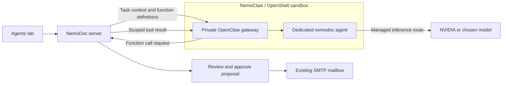

# OpenClaw agents isolated with NVIDIA NemoClaw

NemoDoc can use a dedicated OpenClaw agent through its authenticated Chat Completions gateway. NVIDIA NemoClaw manages that agent inside an OpenShell sandbox. The agent inherits the NVIDIA model (or other supported inference route) chosen during NemoClaw onboarding. `openclaw/nemodoc` is the **agent target**, not an NVIDIA model ID.

This integration isolates the agent first. The NemoDoc app, PostgreSQL database, scheduler and SMTP transport continue running in their existing environment.



## Set up the runtime host

Use a supported Docker host following NVIDIA's [prerequisites](https://docs.nvidia.com/nemoclaw/latest/user-guide/openclaw/get-started/prerequisites) and [official installation quickstart](https://docs.nvidia.com/nemoclaw/latest/user-guide/openclaw/get-started/quickstart). Current Linux requirements include Node 22.19+, npm 10+, 4 CPUs, 8 GiB RAM and 20 GiB disk. Allow room for the sandbox image. A GPU is not required when using hosted NVIDIA inference.

From this checkout on that host:

```bash
npm run agent:preflight
nemoclaw onboard --name nemodoc --agents ./deploy/nemoclaw/agents.yaml
```

The preflight only inspects host prerequisites. If NemoClaw or OpenShell is missing, install them with NVIDIA's supported installer, then rerun it. It does not install anything or read application credentials. The onboarding command above creates a **new dedicated sandbox**. Choose OpenClaw and your NVIDIA inference provider/model during onboarding. Configure its inference credential there; NemoDoc's existing notebook key is not automatically copied. Other models can be selected through NemoClaw's supported inference routes.

The checked-in [agent manifest](../deploy/nemoclaw/agents.yaml) creates `nemodoc` with a minimal built-in tool profile and explicit denials for shell, filesystem, messaging, delegation, automation, gateway administration and plugin tools. It leaves model choice to onboarding. NemoDoc supplies its own client function tools over HTTP; their handlers execute in NemoDoc after validating scope and arguments.

Do not mount this repository, `data/`, `.env`, PostgreSQL credentials or the Docker socket into the agent sandbox. Do not add SMTP or WhatsApp credentials, native messaging channels or additional plugins to this dedicated runtime. OpenShell controls filesystem/process isolation and network egress; keep its managed policy and approve only the inference access required for your selected route.

For an existing sandbox, inspect and back up its state first. The manifest is intended for a fresh dedicated runtime: `agents apply` can remove other agents and does **not** apply tool overrides live. Use NVIDIA's [manifest/rebuild instructions](https://docs.nvidia.com/nemoclaw/latest/user-guide/openclaw/configure-agents/declarative-agents-manifest) when changing an existing installation.

## Enable the private HTTP gateway

OpenClaw disables Chat Completions by default. Enable it inside the dedicated sandbox using the native CLI:

```bash
nemoclaw nemodoc exec -- openclaw config set gateway.http.endpoints.chatCompletions.enabled true --strict-json
nemoclaw nemodoc exec -- openclaw config validate
nemoclaw nemodoc gateway restart
nemoclaw nemodoc agents list --json
nemoclaw nemodoc doctor --json
```

These commands target the reviewed OpenClaw 2026.9.2 gateway surface shipped by current NemoClaw. Use a supported NemoClaw release and its managed OpenClaw version; don't independently replace OpenShell or OpenClaw underneath it. If a later OpenClaw CLI requires stopping its gateway before a config edit, follow that version's native service-owner procedure, then restart through NemoClaw.

Confirm the doctor report has no failed checks, the agent roster contains `nemodoc`, and the configured tool restrictions are present. Doctor may probe inference and consume provider tokens. Inspect the live OpenShell policy and host mounts as described in NVIDIA's [sandbox hardening guide](https://docs.nvidia.com/nemoclaw/latest/user-guide/openclaw/manage-sandboxes/configure-sandboxes/review-sandbox-hardening); doctor success alone is not an isolation audit.

NemoClaw manages the host forward. On the same host, the usual gateway base is `http://127.0.0.1:18789/v1`; check the actual assigned port in your onboarding output. Keep token authentication enabled. Obtain the **gateway token** locally using `nemoclaw nemodoc gateway-token` and paste it only into NemoDoc's password field. Do not post it in logs or commit it. This token grants broad gateway operator access; use a dedicated gateway and keep the endpoint private. An NVIDIA API key is not a gateway token.

For a remote runtime, use an authenticated private HTTPS connection or a loopback SSH forward to its private gateway. There is no need for a public tunnel. When NemoDoc runs in Docker, `127.0.0.1` means the app container; arrange a private HTTPS endpoint reachable from that container. NemoDoc deliberately rejects plain HTTP endpoints outside loopback. The setup above does not change the app or database containers.

## Connect from NemoDoc

1. Open **Agent → Connections → Model connection → OpenClaw agent through NemoClaw**.
2. Enter the gateway base URL, target **`openclaw/nemodoc`**, and gateway token. Save the model connection.
3. Choose **Test gateway tool support**. NemoDoc requests a structured function call, returns a random receipt as a matching tool result, and requires OpenClaw to return that receipt. Both requests must pass before runs are enabled. The test sends no notes or email.
4. Approve selected source/note snapshots, then run a task or evidence workflow. Review citations and any proposed actions before approving them.

The HTTP bridge omits persistent `user` and session headers, so separate runs do not intentionally share an OpenClaw conversation. It sends complete tool history on each continuation. The gateway and inference provider still receive task context, selected metadata and retrieved evidence; inspect their retention settings before using private material. Revoke snapshots in NemoDoc to stop further access; revocation cannot retract context already sent.

NemoDoc validates every returned function name and argument. Evidence workflows retain their read → proposal → approval → outbox sequence. SMTP and WhatsApp secrets stay in the app; the model does not select the recipient. Legacy scheduled tasks retain their existing explicit delivery authorization. Email uses your configured SMTP mailbox, with no additional email service account. See [agent connections](AGENT_CONNECTIONS.md) for weekday scheduling and delivery setup.

Saving or changing the connection resets its test status and pauses legacy tasks. Queued evidence runs reject a changed connection revision. Notebook Chat and Studio retain their existing model policy.

## See your agents and their work

The **Agent → Agents** overview lists the agents configured in your sandbox. Cards show names, models, reported session status and the latest work summary. Each card includes a work animation: typing while the runtime reports running, a raised hand while waiting, and distinct static completed, failed, interrupted, queued or unknown states. The animation illustrates the reported status; it does not simulate additional tool calls or progress. Unknown or failed monitoring reads stop the working animation. Use **Pause animations** to stop motion across the cards; the system reduced-motion preference is always respected. Select **View activity** to filter sessions for one agent. **This notebook** shows NemoDoc tasks/workflows, recent tool steps, proposal approvals and delivery status; **Runtime sessions** shows activity across the sandbox. The view refreshes every five seconds while visible and has a manual refresh button.

For live monitoring, run the NemoDoc server on the NemoClaw host with the `nemoclaw` CLI on its `PATH`. Set the sandbox name in the server environment, then restart NemoDoc:

```dotenv
NEMODOC_NEMOCLAW_SANDBOX=nemodoc
```

The default server sandbox name is `nemodoc`. It must match the sandbox behind your configured gateway. Monitoring uses fixed read-only commands, `nemoclaw <sandbox> agents list --json` and `nemoclaw <sandbox> exec -- openclaw gateway call sessions.list --params ... --json`. It never invokes inference, starts agents, runs a doctor probe or grants the model monitoring tools. The server returns selected metadata and up to 100 recent session records; it omits raw CLI errors, filesystem paths, session routing keys and conversation transcripts. Runtime-wide labels and work summaries are visible in this local administration UI; notebook task details are scoped to the selected notebook.

For a remote gateway without host CLI access, the overview can list its `/v1/models` agent targets. It marks that view as **Limited runtime visibility**: the Chat Completions API alone does not expose live session activity. A disconnected or unsupported runtime shows an explicit unavailable state. Recent timestamps are never treated as proof that an agent is working or idle. The connection badge reports monitoring access and does not attest OpenShell containment.

The current monitor targets OpenClaw agents inside the chosen NemoClaw sandbox. Other runtime variants such as Hermes need their own status adapter.

## Assign models and Markdown roles

Open **Agent → Settings**, choose **Configure roles & models**, or use **Agent settings** on an agent card. These screens are NemoDoc UI backed by OpenClaw's native configuration and workspace-file APIs. They do not embed OpenClaw's Control UI.

1. Select an existing agent, or enter a new name and choose **Create agent**. Each new agent gets a separate OpenClaw workspace and a minimal built-in tool profile with explicit denials for shell, filesystem, messaging, delegation and gateway administration. No task starts during setup. If creation succeeds but restrictions cannot be confirmed, the screen reports incomplete setup; use **Apply NemoDoc tool restrictions** before running that agent.
2. Choose a **Primary model** and up to five distinct **Fallback model IDs**. Fallbacks are tried in their displayed order. Different agents can use different models, for example a study model for one and a research model for another. The picker reads the runtime's configured catalog without starting inference or provider discovery. **Enter an exact provider/model ID** is available when a model isn't in the picker. Provider credentials and permitted inference routes must already be configured in NemoClaw; this screen does not provision them or establish model availability. **Inherit runtime default** removes this agent's model override.
3. Edit **AGENTS.md** for operating instructions, priorities and the agent's role. Use **SOUL.md** for personality, tone and boundaries. **Insert role template** offers Study coach, Researcher, Writer and Reviewer; it replaces only the marked NemoDoc role block and preserves the rest of the file. You can edit custom Markdown, preview it, download a draft and save it to the selected agent's actual runtime workspace. The identity name form uses OpenClaw's native identity update, which manages `IDENTITY.md`.
4. Choose **Use this agent in NemoDoc** to change the configured gateway target, then test its connection. Task and evidence-workflow permissions continue to be controlled by NemoDoc.

The editor requires native CLI access on the configured NemoClaw host; a remote `/v1/models` inventory alone cannot manage role files. Native calls are restricted to the supported agent, model/configuration and Markdown-file operations; there is no general command, RPC or filesystem proxy. Saves of model routing, identity and each role file are separate actions. Model/config changes may reload the gateway. New sessions load the updated Markdown; existing conversations may retain earlier instructions. Large files can exceed OpenClaw's bootstrap injection limits, so keep role instructions concise.

Model routing uses a fresh native config hash and a patch limited to the selected agent's keyed roster entry. Other agents, provider credentials and tool settings are preserved. Role saves compare the loaded file revision with current content before writing and read the file back afterward. This catches stale edits from another editor; OpenClaw's file API does not provide an atomic compare-and-swap against simultaneous external writers. Conflicts and uncertain writes keep the draft visible and require reloading rather than automatically replaying a write.

Markdown drafts stay in browser memory while switching agents, settings views and notebooks. File reloads prompt before discarding a draft. They are not saved to browser storage; download the draft before closing the app if it must be retained. The preview displays text without loading external images or following embedded links.

Updating the agent currently selected in NemoDoc pauses its legacy tasks, clears its tested flag and changes its persisted runtime revision. Existing workflow approvals remain invalid even after a successful new connection test or server restart. Edits to another agent do not change the selected agent's connection. Markdown role text does not grant tools, filesystem access, sandbox permissions or delivery approval.

See OpenClaw's [workspace file map](https://docs.openclaw.ai/concepts/agent-workspace) and [multi-agent documentation](https://docs.openclaw.ai/concepts/multi-agent).

## Verification and troubleshooting

`npm test` includes a private loopback HTTP gateway fixture that exercises bearer authentication, agent routing, structured calls/results, scoped evidence and approval before SMTP submission. Browser tests cover selecting, saving and testing the OpenClaw connection. These fixtures do not run OpenClaw, NVIDIA inference or OpenShell and do not attest sandbox containment.

Agent-configuration fixtures additionally exercise native RPC argument contracts, per-agent model/fallback changes, role-file persistence, conflicts, partial creation, durable approval invalidation and selection. Browser scenarios verify role templates, Markdown drafts, multiple models, fallback ordering and reload behavior. These are contract fixtures; native writes against a live NemoClaw installation remain to be verified on the runtime host.

The development environment used for this change has Docker but no NemoClaw/OpenShell installation. A live NVIDIA → OpenClaw → NemoDoc workflow and real OS containment must therefore be verified on the configured runtime host using the steps above. No live email or recurring delivery was enabled during development.

- **401/403:** use the gateway token from this dedicated sandbox, rather than your NVIDIA key.
- **404:** check the assigned port, `/v1` base URL, enabled Chat Completions endpoint and native gateway restart.
- **Tool round trip fails:** check managed OpenClaw version and [client function-tool support](https://docs.openclaw.ai/gateway/openai-http-api). A text answer or `/models` response does not prove tools work.
- **Gateway passes but runtime is unhealthy:** inspect `nemoclaw nemodoc doctor --json` and the live OpenShell policy on the runtime host. The app test checks gateway behavior, not sandbox ownership or containment.

Reference: [NVIDIA CLI commands](https://docs.nvidia.com/nemoclaw/latest/user-guide/openclaw/reference/commands), [OpenClaw HTTP gateway](https://docs.openclaw.ai/gateway/openai-http-api).
